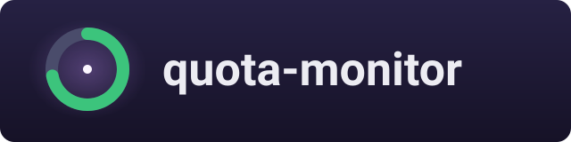
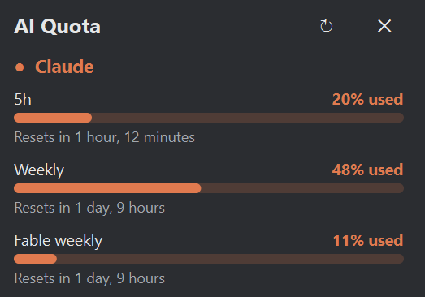

<p align="center">
  
</p>

<p align="center">
  A tray app for Windows and Linux that shows AI subscription limits and API balances in one panel.
</p>

<p align="center">
  <a href="/LICENSE"></a>
</p>

---

**Contents**

- [Why it exists](#why-it-exists)
- [Features](#features)
- [Set it up](#set-it-up)
- [Limits](#limits)
- [License](#license)

## Why it exists

Each AI subscription shows its usage on its own page, over its own windows (5 hours, weekly,
monthly) and in its own units (percent of a limit, credits, a prepaid balance). This app polls the
providers you enable and shows all of them in one panel that opens from the system tray.

## Features

<p align="center">
  
</p>

### Six providers

- **Claude**: 5h, weekly and per-model weekly limits
- **Codex**: 5h, weekly and model-specific limits, credits
- **Antigravity**: 5h and weekly limits for the Gemini and Claude/GPT groups
- **Command Code**: 5h, weekly and monthly limits
- **DeepSeek**: prepaid balance
- **OpenCode Go**: 5h, weekly and monthly limits

Claude, Codex and Antigravity sign in from the tray menu. Command Code, DeepSeek and OpenCode Go
read their credentials from `.env`. In `config.toml`, the order of the providers is the order in the
panel, and `enabled = false` hides one.

### The tray icon

The ring on the icon shows the highest usage across all tracked windows. A left click opens or
closes the panel, and a right click opens the menu with **Open**, **Refresh now**, the sign-ins,
**Start at login** and **Quit**.

### Polling and stored values

The app polls every enabled provider at the interval set by `poll_interval_minutes` in
`config.toml`, 5 minutes as shipped, and keeps the last values in a SQLite file. A provider that
fails shows its error in the panel together with its last known values.

### Command line

`python -m quota_monitor poll` polls once and stores the result, and `python -m quota_monitor status`
prints the stored values. Neither needs the tray dependencies. `python -m quota_monitor tray --demo`
shows the panel with fake data and needs no credentials.

## Set it up

You need Python 3.11 or later. Keep the folder on a local disk.

### Install

On Windows, run these commands in PowerShell from the project folder:

```powershell
py -m venv .venv
.venv\Scripts\pip install -r requirements.txt
Copy-Item .env.example .env
```

On Linux (the package names are for Debian-based systems such as Mint):

```bash
sudo apt install python3-venv libxcb-cursor0
python3 -m venv .venv
.venv/bin/pip install -r requirements.txt
cp .env.example .env
chmod 600 .env
```

Set `enabled = false` in `config.toml` for each provider you do not use, and fill in `.env` as
described under [Credentials](#credentials).

### Start

- **Windows:** double-click `run_tray.pyw`.
- **Linux:** run `.venv/bin/python run_tray.pyw`. The terminal can be closed afterwards.

The app runs in the background with an icon in the tray. From the icon's right-click menu:

1. Choose **Sign in to Claude…**, **Sign in to Codex…** and **Sign in to Antigravity…**. Each one
   opens the browser. The sign-ins are saved and renewed automatically.
2. Tick **Start at login**.

### Credentials

**DeepSeek:** set `DEEPSEEK_API_KEY=sk-...` in `.env`.

**Command Code:**

1. Sign in at [commandcode.ai](https://commandcode.ai).
2. Press F12, open the **Network** tab and reload the page.
3. Select a request to `api.commandcode.ai`, for example `credits`.
4. Under **Request Headers**, copy the value of `Cookie`.
5. Set `COMMANDCODE_COOKIE=<copied value>` in `.env` and choose **Refresh now** in the tray menu.

Repeat these steps when the panel reports an expired Command Code session.

**OpenCode Go:**

1. Sign in at [opencode.ai/console](https://opencode.ai/console) and open the **Go** page.
2. Set `OPENCODE_ORG` in `.env` to that page's URL or its `org_...` id.
3. Press F12, open the **Network** tab, select **Fetch/XHR** and reload.
4. Select the `status` request and, under **Request Headers**, copy the whole `Cookie` value.
5. Set `OPENCODE_COOKIE=<copied value>` in `.env` and choose **Refresh now** in the tray menu.

Repeat these steps when the panel reports an expired OpenCode session.

## Limits

> [!WARNING]
> Google's terms prohibit using Antigravity sign-ins in software other than Google's. Accounts have
> been suspended for it.

- The Claude, Codex, Antigravity, Command Code and OpenCode Go endpoints are undocumented and can
  change.
- Sign-ins are stored in `data/auth/`. Deleting a file there signs that provider out.
- Errors from the background process are written to `data/tray.log`.
- After moving the project folder, untick and tick **Start at login** again.

## License

This project is released under the [MIT License](/LICENSE).

It is an independent project. It is not affiliated with, endorsed by, or connected to Anthropic,
OpenAI, Google, DeepSeek, Command Code, or OpenCode. Product names belong to their owners.
